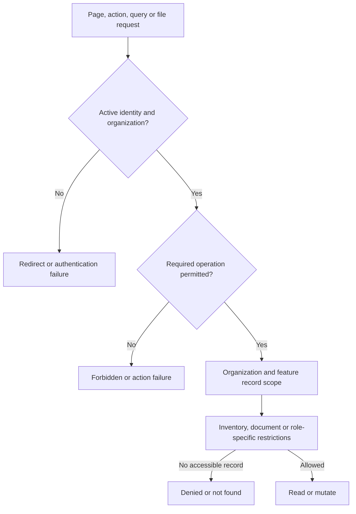
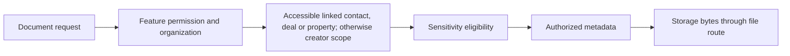

# Access control

Authorization is layered. Navigation visibility is not enforcement, and an organization-wide data scope is not equivalent to every administrator privilege.

## Decision flow

Sources: [authorization.ts](../src/lib/permissions/authorization.ts), [policy.ts](../src/lib/permissions/policy.ts), [catalog.ts](../src/lib/permissions/catalog.ts). Inspect the caller for exact error/status behavior; inaccessible resources are often returned as not found.

## Permissions and scope

- Permission grants are database-driven through roles, user roles and role permissions, then each user's own changes in `user_permissions` (granted adds a key, false removes it). The catalog defines recognized keys and defaults; it is not a dump of live administrator choices.
- Data access is three permissions: `records.view_own`, `records.view_team` and `records.view_all` ("Data access" on the Roles page and the user's Permissions section). `resolveDataScope` uses the broadest of these the user holds, from roles and their own `user_permissions`; there is no administrator shortcut. Holding none means own records only.
- `users.data_scope_override` and `roles.data_scope` are retired: migration 0048 turned them into these permissions and nothing reads them now.
- [dataScopeCondition](../src/lib/permissions/scope.ts) always constrains organization. With owner columns, `own` matches the user; team scope (the literal `broker_team`) combines own records, directly linked users whose `brokerId` is the caller, and the supplied broker column.
- The generic scope helper is column-dependent. Without owner/broker columns, its result can be organization-only; inventory adds explicit grant predicates. Do not reuse it without understanding the columns supplied.
- Team scope is not recursive organization-chart traversal. Calendar visibility also has creator/invitee rules in [calendar queries](../src/features/calendar/queries/calendar.queries.ts); use the feature's predicates rather than imposing a universal ownership rule.

## Feature-specific restrictions

| Area | Rule to preserve |
| --- | --- |
| Billing | `canViewBilling` requires `billing.view`; `canManageBilling` also requires `billing.manage`. Bills, payments and the Payments list are limited to opportunities in the user's data access. |
| General user management | `canManageUsers` requires `users.manage`. A caller may only change users with no permission the caller lacks (`canChangeUser`) and only assign roles with no permission the caller lacks (`canAssignRoles`); the Super Administrator is exempt and is never changed here. Broker onboarding uses a separate own-agent path. |
| Audit log | Requires `settings.audit` through `canViewAuditLog`. |
| Pipeline | Every move to an earlier stage, reopening won/cancelled included, needs `deals.move_back`. Move-role classification still treats master broker as `admin` for moving any opportunity, skipping stages back and changing a closed outcome. |
| Broker reassignment | Action checks reassignment permission and organization-wide access (`records.view_all`). Closed-won override explicitly requires super-administrator. |

Sources: [policy](../src/lib/permissions/policy.ts), [stage transitions](../src/features/deals/lib/stage-transitions.ts), [contact actions](../src/features/contacts/actions/contact.actions.ts), [settings actions](../src/features/settings/actions/settings.actions.ts).

## Inventory grants

[property-access.ts](../src/lib/permissions/property-access.ts) supplies separate property, floor and unit predicates. Administrators have unrestricted inventory access within the surrounding organization checks. Other users need explicit grants; broad data scope alone does not bypass these.

A property-level grant can expose the property while limiting its floors/units. Positive targets select floors or units; no positive targets denotes whole-property access. Unit exclusion logic is applied in the targeted branch; do not assume exclusions override the whole-property branch. Review the actual predicate and [grant actions](../src/features/properties/actions/property-access.actions.ts) together when changing this behavior.

Grantor eligibility and eligible recipients are separate checks. Broker grant recipients are restricted by broker relationships; master broker and administrator paths have different reach. Inventory writes also use [property-scope.ts](../src/features/properties/lib/property-scope.ts); read access is not automatically write access.

## Documents and file routes

[document-scope.ts](../src/features/documents/lib/document-scope.ts) combines contact/deal/property branches with OR; an unlinked document follows creator scope. Do not rewrite that as requiring access to every linked record. Property-linked access follows inventory grants.

Sensitivity is an additional condition: explicit `documents.view_sensitive`, selected managerial/admin roles, or the implemented deal-participant exception can allow it. The normal scope condition still applies. [document-sensitivity.ts](../src/features/documents/lib/document-sensitivity.ts) marks contract, reservation and proof-of-income categories sensitive on upload.

User onboarding documents have separate settings queries/routes. General document lists exclude user-linked records. Trace the specific preview/download query and [file-route helpers](../src/lib/http/file-route.ts), not just the UI page.

## Validation scenarios

For access changes, check permitted and denied callers, another organization, own versus team versus organization scope, direct URL/action access, deleted/inactive identities, targeted inventory access, and sensitive document download. Verify related-record selectors and write actions agree. See the [validation matrix](development.md#validation-matrix).

**Update when:** permission keys/defaults, scope precedence, ownership predicates, grant delegation, sensitive-document policy, or feature role exceptions change.
