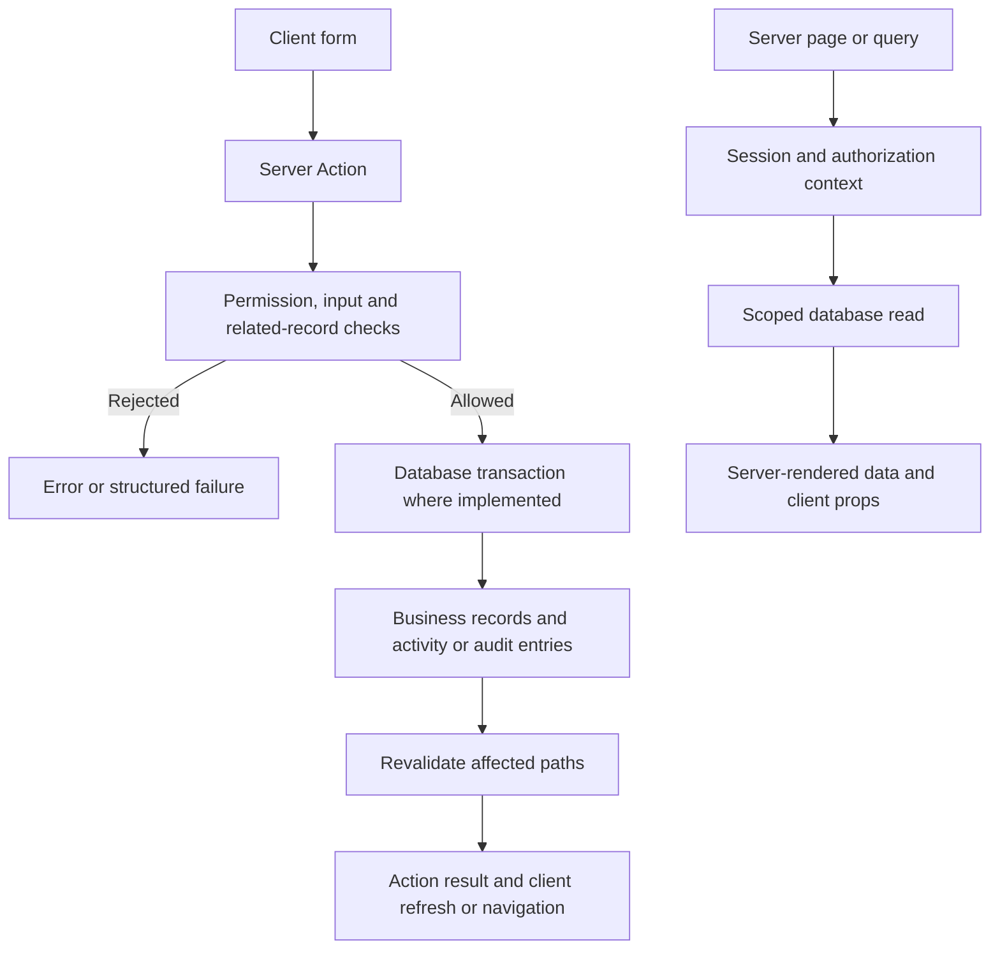
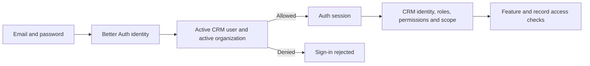
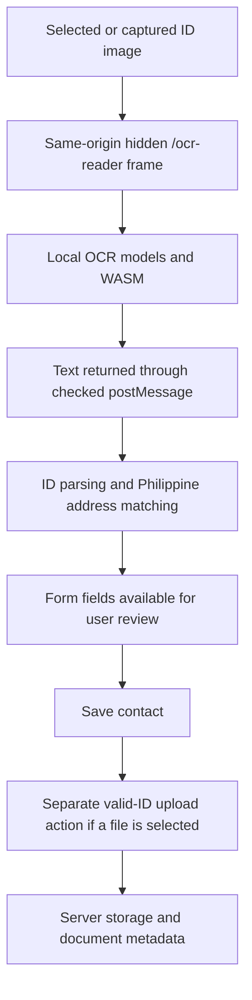

# Architecture and technical flows

## Code map

The installed stack is Next.js 16.4.2, React 19, TypeScript, PostgreSQL/Drizzle, Better Auth and Tailwind. Use [package.json](../package.json) for versions/scripts and [AGENTS.md](../AGENTS.md) for the requirement to consult installed framework guides.

| Location | Responsibility |
| --- | --- |
| [app](../app) | App Router pages/layouts, `(auth)` and `(crm)` groups, API routes, error/loading boundaries |
| [src/features](../src/features) | Feature components, server queries, Server Actions, schemas and business helpers |
| [src/components](../src/components) | Shared UI, page scaffolding, shell and navigation |
| [src/lib](../src/lib) | Auth, permission predicates, file handling, providers, errors, logging, dates and system metrics |
| [src/db](../src/db) | PostgreSQL pool, Drizzle schema, migrations, seeds and database scripts |

The `@/*` alias resolves to `src/*`, not the repository root. Server query modules generally use `server-only`; mutations use `"use server"`. Interactive forms, charts and browser APIs live in client components. Feature boundaries are conventions, not strict isolation: contacts call deal helpers and multiple modules share permission predicates.

## Request and mutation flow

This is a common pattern, not a guarantee that every action has identical validation order or transaction boundaries. [Task actions](../src/features/tasks/actions/task.actions.ts) are a readable example. [ActionResult](../src/lib/types/action-result.ts) carries success data or structured errors; legacy unit actions use a different shape. See [development conventions](development.md#implementation-conventions).

Page permission checks redirect unauthenticated users to login and denied users to forbidden. Action/query authorization throws; individual callers may convert failures into results or HTTP status codes. Never rely solely on the CRM layout or hidden buttons to authorize a mutation.

## Identity and core data

[Better Auth](../src/lib/auth/auth.ts) owns `auth_*` tables and disables public signup. `auth_users.crm_user_id` links to CRM `users`. [Authorization](../src/lib/permissions/authorization.ts) rechecks active/non-deleted identity and organization, then loads role grants; its context is memoized per request with React `cache`.

Key relationships in the [schema](../src/db/schema): organizations contain CRM users and business records; roles connect users to permissions; contacts connect to deals through `deal_contacts`; deals reference stages and optional inventory; developments group properties, which contain floors/units; documents can link to business records or users. Tasks, events, history and audit records support those workflows. Do not infer working features from schema tables alone.

## Files and OCR

[Document storage](../src/lib/storage/document-storage.ts) stores bytes under `.data/documents`; database rows hold storage keys and metadata. [Image upload helpers](../src/lib/storage/image-uploads.ts) reuse storage infrastructure. API download/image routes load authorized records before serving bytes; inspect the particular route and query when changing file access.

[read-id.ts](../src/features/contacts/lib/read-id.ts) performs OCR in the browser, with origin/source checks on replies. This does **not** mean the ID file is never uploaded: [contact-form.tsx](../src/features/contacts/components/contact-form.tsx) separately uploads it after saving. OCR failure leaves manual entry available.

[next.config.ts](../next.config.ts) isolates the OCR frame's relaxed CSP from the main application. [copy-ocr-assets.mjs](../scripts/copy-ocr-assets.mjs) generates local models/runtime files and a UTF-8 vendor copy before `dev`/`build`; avoid editing those outputs.

## Integrations and execution

| Flow | Implementation and limitation |
| --- | --- |
| Password reset | Auth callback → [reset email](../src/lib/auth/email.ts) → [SMTP service](../src/lib/email/email-service.ts). Without configuration, development logs email content; runtime delivery is not established by a successful reset request. |
| Marketing email | User send action → recipient handling → [Resend provider](../src/lib/messaging/providers.ts) → persisted delivery results. Requires `RESEND_API_KEY` and `RESEND_FROM_EMAIL`. |
| Automation | Enrollment → user-triggered `executeNextStep` → action and run record. [Marketing actions](../src/features/marketing/actions/marketing.actions.ts) claim progress and record failures; no background worker was found. |
| SMS/social | SMS factory returns `null`; social sends are rejected. These require implementation, not just credentials. |
| E-signatures | Signer records → request action → [provider factory](../src/lib/esign/provider.ts) returning `null` → configuration-required failure. No working envelope delivery is established. |

**Known discrepancy (2026-11-04, source inspection):** the root README lists SMTP or Resend for password reset, but the reset code uses the SMTP service. Resend is wired to marketing. Keep these configuration paths separate.

## Runtime and deployment

[Docker Compose](../docker-compose.yml) runs a one-off migrator before starting the standalone app and persists `.data` in the documents volume. It expects an external database/network; it is not a bundled local PostgreSQL setup. Follow the [root README](../README.md) for operations.

[instrumentation.ts](../instrumentation.ts) starts in-process system monitoring. The public [health route](../app/api/health/route.ts) returns a static OK response; it does not prove database connectivity or provider health. Reports and dashboards have their own query modules and access checks.

**Update when:** module boundaries, auth/data flow, core relationships, storage, OCR security/assets, provider behavior, or runtime topology changes.
