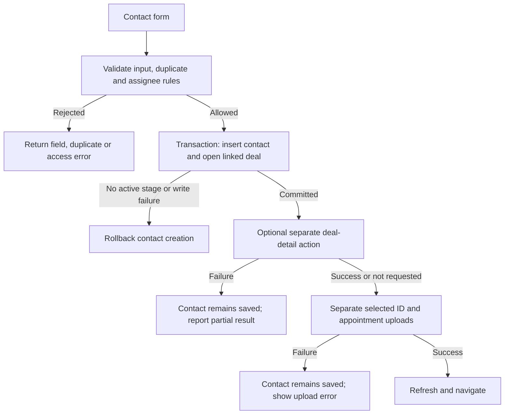
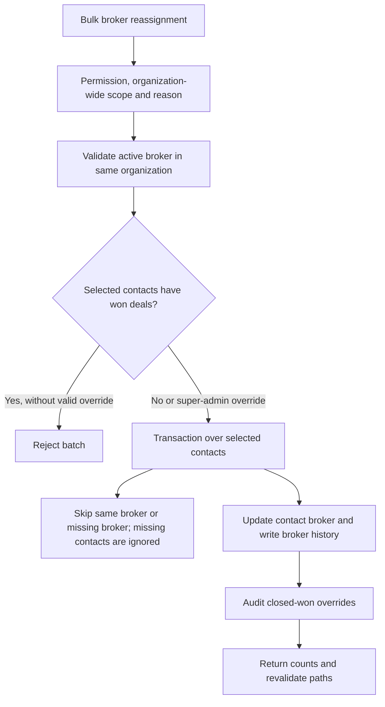
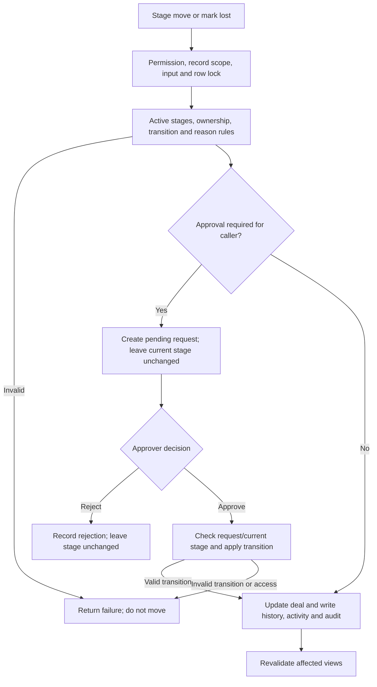
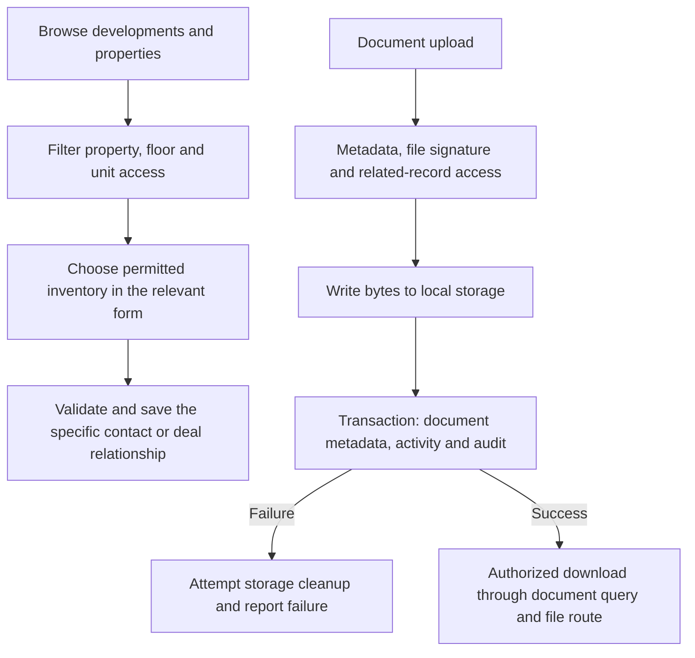

# Sales and related system flows

These flows describe source behavior as inspected on 2026-11-04. Database configuration may differ from seeds. Authorization details belong in [access control](access-control.md).

## Contact intake and deal creation

Sources: [contact actions](../src/features/contacts/actions/contact.actions.ts), [open-deal helper](../src/features/deals/lib/open-deal.ts), [contact form](../src/features/contacts/components/contact-form.tsx), [deal actions](../src/features/deals/actions/deal.actions.ts).

- `insertContact` calls `openDealForApprovedContact` during creation without an approval-status gate. The helper's name and history message do not mean deal creation waits for approval.
- The helper reuses an existing non-deleted linked deal if found; it does not filter that lookup to open deals. Otherwise it selects an active stage (first by position unless specified), inherits assignment/broker and preferred development, and writes deal linkage, history, activity and audit records in the caller's transaction.
- Exact duplicate email/mobile matches block ordinary creation. The force path checks organization-wide access, despite the administrator wording in its comment. Duplicate details are filtered for caller visibility. CSV imports have skip/update handling and per-row savepoints; do not promise all-or-nothing import semantics. See [duplicate lookup](../src/features/contacts/lib/contact-duplicate-lookup.ts) and [CSV helpers](../src/features/contacts/lib/contact-csv.ts).
- CSV creation differs from form creation: its deal-opening call is gated by the resolved import approval status. Inspect `runImport` and `importApprovalStatus` before changing either intake path; do not generalize the form flow to every import row.
- Contact approval updates its approval fields and records activity/audit. Changing to approved invokes the deal-opening helper; changing away from approved does not delete the deal.
- Contact save, optional deal details, and subsequent uploads are separate operations. Preserve partial-success reporting. OCR and upload are also separate: see [architecture](architecture.md#files-and-ocr).

## Assignment and broker reassignment

Ordinary contact editing can derive the broker from a newly selected agent's `brokerId` (or the selected user's ID) and write assignment/broker histories. Bulk reassignment is a distinct action with its own guards and a 500-contact limit.

**Current behavior to preserve or explicitly discuss:** bulk `reassignContactBroker` updates the contact broker, not `users.brokerId`, contact assignee, or existing deal ownership. Ordinary contact updates likewise should not be treated as an automatic deal ownership cascade. Check the separate deal action and its actual update fields when a task intends ownership synchronization. The UI wording alone is insufficient evidence.

Sources: [contact actions](../src/features/contacts/actions/contact.actions.ts), [assignment helpers](../src/features/contacts/lib/assignment.ts), [deal actions](../src/features/deals/actions/deal.actions.ts). Broker-agent account onboarding and user relationship changes are separate [settings actions](../src/features/settings/actions/settings.actions.ts).

## Pipeline transitions and approvals

The [stage seed](../src/db/seeds/pipeline-stages.ts) defines Leads → Opportunity & Reservation → CTS Signed - Won, plus Closed - Lost. Runtime stages come from the database. Cancellation handling exists even though this seed does not add a cancelled stage.

- Forward progression is one position at a time except allowed terminal outcomes. Moving an opportunity back, reopening won/cancelled included, needs `deals.move_back`; admin move roles may go back several positions, others one at a time. Backward moves require a reason.
- Recording a Reservation payment moves Opportunity to Reservation once Reservation payments cover the reservation fee; a Monthly payment moves Reservation to Won once Monthly payments cover the monthly amortization.
- Agents/brokers have own-opportunity checks. Changing a won/cancelled outcome forward requires the `admin` move classification; reopening it backward requires `deals.move_back` and a reason. See [stage-transitions.ts](../src/features/deals/lib/stage-transitions.ts) for classification and special cases.
- Callers without approval permission need approval for gated destinations, and for a lost outcome after entering a gated stage. Reason requirements also depend on direction, outcome and approval permission.
- `changeDealStage`, `markDealLost`, approval and rejection actions have distinct validation paths. Lost-reason metadata must survive a pending request and its approval. Pending success is not a completed stage move.
- Approval rejects already-decided requests and self-approval, then re-evaluates the transition from the deal's current stage. It does not explicitly require that stage to equal the request's original `fromStageId`. Rejection requires a reason. Test stale requests rather than assuming a stronger stale-state guard.
- Applied moves update stage/status/probability and close date (using Manila dates), with stage history, activity and audit records. Reopening clears the actual close date. Same-stage requests can return success without a move.

Sources: [deal actions](../src/features/deals/actions/deal.actions.ts), [stage rules](../src/features/deals/lib/stage-transitions.ts), [UI move helpers](../src/features/deals/lib/stage-move.ts). Change server and UI rules together; server checks remain authoritative.

## Inventory and document interactions

Contact preferences (`preferredDevelopmentId`, `preferredUnitIds`) and deal inventory fields are distinct. A selection does not by itself prove a reservation, inventory-status change, or exclusive unit allocation. Inspect the action's writes before documenting such a side effect.

[Inventory selectors](../src/features/properties/components/property-floor-unit-selector.tsx) use property/floor/unit endpoints and queries. [Unit actions](../src/features/properties/actions/unit.actions.ts) manage generated floors/units and images; [property actions](../src/features/properties/actions/property.actions.ts) manage property data. Access checks must survive direct requests, not only filtered selectors.

[Document actions](../src/features/documents/actions/document.actions.ts) validate file metadata/signatures and related records, write bytes, then persist records. File storage and PostgreSQL are not one transaction; failure cleanup is best effort. Contact ID/appointment uploads and settings user documents have separate actions and permissions. Adding signer records does not make e-signature sending functional.

## Payments and follow-up

[Reservation payment actions](../src/features/billing/actions/billing.actions.ts) require billing management and an opportunity in the user's data access. Payments are recorded per bill and classified Reservation, Monthly or Full; they advance the pipeline (see Sales pipeline rules). The deal's `reservation_fee_paid_at`/`_by` columns are retired and unused. `npm run db:report-unpaid-stages` lists deals in Reservation or Won that their payments don't cover. It does not charge a payment provider.

[Task actions](../src/features/tasks/actions/task.actions.ts) validate linked records before creation. [Calendar actions](../src/features/calendar/actions/calendar.actions.ts) create events/viewings and update viewing feedback/status. Their existence does not imply automatic creation on every pipeline transition.

**Update when:** intake, assignment, approval, stage, inventory linkage, document, payment or follow-up behavior changes, especially transaction boundaries and side effects.
